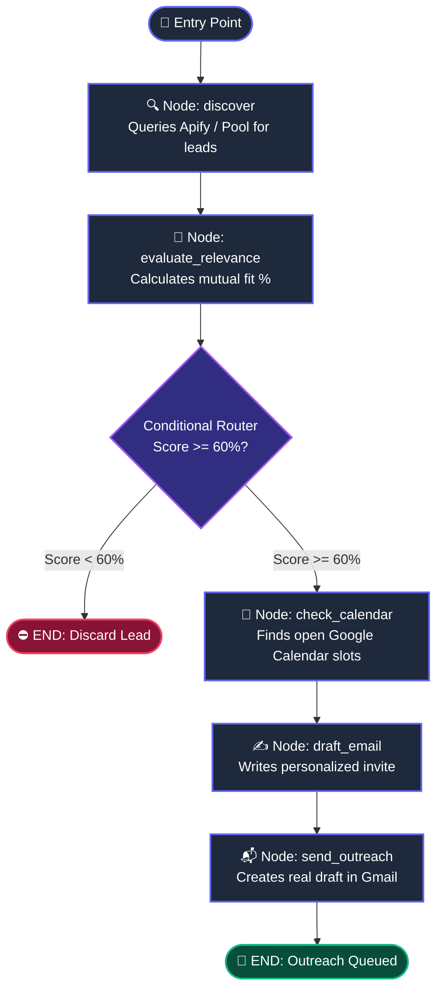

# 📘 LangGraph & AI Agents: The Complete Beginner's Knowledge Base

> This document is your personal knowledge companion for understanding **LangGraph**, **AI Agent architectures**, and stateful multi-step reasoning. Keep it handy as a quick-reference guide.

---

## 📑 Table of Contents
1. [What is an AI Agent?](#1-what-is-an-ai-agent)
2. [Why LangGraph? (Chains vs. Graphs)](#2-why-langgraph-chains-vs-graphs)
3. [The 4 Core Pillars of LangGraph](#3-the-4-core-pillars-of-langgraph)
4. [How NetworkPilot Works (Visual Walkthrough)](#4-how-networkpilot-works-visual-walkthrough)
5. [Advanced Agent Concepts](#5-advanced-agent-concepts)
6. [Top 5 Mistakes Beginners Make (And Fixes)](#6-top-5-mistakes-beginners-make-and-fixes)
7. [The 5-Step LangGraph Blueprint (Cheat Sheet)](#7-the-5-step-langgraph-blueprint-cheat-sheet)

---

## 1. What is an AI Agent?

Most people start by using an LLM as a single input-output generator:
$$\text{Prompt} \longrightarrow [\text{LLM}] \longrightarrow \text{Response}$$

An **AI Agent** is fundamentally different. An agent can:
- **Plan**: Break down complex goals into smaller logical steps.
- **Act (Tool Use)**: Call external APIs (e.g. scrape LinkedIn via Apify, check Google Calendar, create Gmail drafts).
- **Observe & Evaluate**: Inspect the output of a tool and calculate whether it succeeded or failed.
- **Branch**: Decide dynamically what step to take next based on observations.
- **Collaborate with Humans**: Pause before taking high-stakes actions (Human-in-the-Loop).

---

## 2. Why LangGraph? (Chains vs. Graphs)

Before LangGraph, people built agents using **linear chains** (like LangChain LCEL):
$$\text{Step A} \longrightarrow \text{Step B} \longrightarrow \text{Step C}$$

### The Problem with Linear Chains
Real-world agent workflows are **rarely straight lines**. In real life:
- You need **loops**: *"Search failed? Try another search query."*
- You need **conditional branches**: *"Score < 60%? Discard. Score >= 60%? Draft email."*
- You need **pause and resume**: *"Wait for human approval before sending an email."*
- You need **memory**: Remembering what happened 3 steps ago without losing context.

**LangGraph solves this by modeling agents as a Directed Graph (a flowchart with memory).**

---

## 3. The 4 Core Pillars of LangGraph

LangGraph has only **four essential building blocks**:

```
        ┌─────────────────────────────────────────────────┐
        │            1. STATE (The Whiteboard)            │
        │ Shared memory dict passed from worker to worker │
        └────────────────────────┬────────────────────────┘
                                 │
                 ┌───────────────┴───────────────┐
                 ▼                               ▼
       2. NODE (The Worker)            4. CONDITIONAL EDGE
       Pure Python function            (The Traffic Police)
       Takes state, returns update     Decides where to go next
                 │                               │
                 └───────────────┬───────────────┘
                                 ▼
                         3. EDGE (Conveyor Belt)
                         Connects Step A to Step B
```

### Pillar 1: The State (`state.py`)
The **State** is the central data contract flowing through every node. It acts as the single source of truth (the shared whiteboard).
* Defined using Python's standard `TypedDict`.
* Every node reads from it, and every node returns updates to it.
* **Our Project Example**: [`state.py`](file:///c:/Users/91934/source/repos/NetworkPilot/state.py)
  ```python
  from typing import TypedDict, List, Optional

  class AgentState(TypedDict):
      user_name: str
      current_lead: Optional[dict]
      match_score: int
      available_slots: List[str]
      email_draft: Optional[dict]
      human_decision: Optional[str]
      status: str
  ```

### Pillar 2: The Nodes (`nodes.py`)
A **Node** is a regular Python function that performs **one distinct task**.
* **Signature**: It always takes `state: AgentState` as input.
* **Return Value**: It returns a `dict` with **only the fields it wants to update**. LangGraph automatically merges those keys back into the central state.
* **Our Project Example**: [`nodes.py`](file:///c:/Users/91934/source/repos/NetworkPilot/nodes.py)
  ```python
  def evaluate_relevance_node(state: AgentState) -> dict:
      candidate = state["current_lead"]
      # Calculate synergy
      score = 85
      return {
          "match_score": score,
          "status": "evaluated"
      }
  ```

### Pillar 3: Edges (`graph.py`)
An **Edge** is a deterministic conveyor belt connecting one step directly to the next.
```python
workflow.add_edge("discover", "evaluate_relevance")
```
*Meaning: As soon as `discover` finishes, immediately execute `evaluate_relevance`.*

### Pillar 4: Conditional Edges (`graph.py`)
A **Conditional Edge** is an intelligent junction. It runs a routing function that looks at the runtime state and decides which node to execute next.
```python
def route_by_relevance(state: AgentState) -> str:
    if state["match_score"] >= 60:
        return "check_calendar"   # High synergy -> proceed
    else:
        return END                # Low synergy -> stop!

workflow.add_conditional_edges("evaluate_relevance", route_by_relevance)
```

---

## 4. How NetworkPilot Works (Visual Walkthrough)

Here is how the 4 pillars assemble our autonomous networking agent:



---

## 5. Advanced Agent Concepts

### 1. Human-In-The-Loop (HITL)
In production, you never want an agent to autonomously perform irreversible actions (e.g. charging credit cards, sending emails to executives, deleting databases) without human supervision.
* **LangGraph Approach**: An approval node pauses the execution, presents the proposed action to the human, and routes based on the human's decision (`approve` ➔ dispatch, `reject` ➔ cancel).

### 2. State Reducers (`Annotated[list, add]`)
By default, when a node returns a key (e.g. `{"status": "ready"}`), it **overwrites** the previous value.
What if you want to **append** messages to a conversation history instead of overwriting?
You use LangGraph's built-in reducer:
```python
from typing import Annotated
from operator import add

class ChatState(TypedDict):
    # Appends new items to the list instead of replacing!
    messages: Annotated[list, add]
```

### 3. Checkpointers & Memory (`MemorySaver`)
LangGraph graphs can remember their state across days or system reboots.
By attaching a checkpointer (`workflow.compile(checkpointer=MemorySaver())`), LangGraph saves a snapshot of the whiteboard at every node into a database (SQLite, Postgres, Redis). If a server restarts, the agent resumes right where it left off!

---

## 6. Top 5 Mistakes Beginners Make (And Fixes)

| # | Mistake | Why it breaks | Correct Pattern |
| - | :--- | :--- | :--- |
| **1** | Returning the entire modified state from a node | Causes race conditions & clutter | Return **only** the keys you updated: `return {"score": 90}` |
| **2** | Forgetting to handle the `END` condition in routing | Causes the graph to loop infinitely or crash | Always have a fallback exit path leading to `END` |
| **3** | Putting API keys inside graph nodes | Makes nodes un-testable and hard to reuse | Keep external tools in a separate [`services.py`](file:///c:/Users/91934/source/repos/NetworkPilot/services.py) |
| **4** | Mutating state directly (`state["score"] = 90`) | Breaks state history and time-travel debugging | Treat state as read-only; return updates in a new dict |
| **5** | Hardcoding linear steps instead of conditional edges | Defeats the purpose of using an agent graph | Use conditional routers for branching and decision-making |

---

## 7. The 5-Step LangGraph Blueprint (Cheat Sheet)

Whenever you build any new AI agent in the future, follow this standard recipe:

```python
from langgraph.graph import StateGraph, END
from typing import TypedDict

# Step 1: Define the State Schema
class MyAgentState(TypedDict):
    user_query: str
    result: str

# Step 2: Write Node Functions
def research_node(state: MyAgentState) -> dict:
    return {"result": f"Researched: {state['user_query']}"}

# Step 3: Initialize the StateGraph
workflow = StateGraph(MyAgentState)

# Step 4: Register Nodes & Edges
workflow.add_node("research", research_node)
workflow.set_entry_point("research")
workflow.add_edge("research", END)

# Step 5: Compile and Run!
app = workflow.compile()
output = app.invoke({"user_query": "Explain LangGraph"})
print(output)
```

---

*Keep this knowledge file as your reference whenever you build autonomous agents or explore advanced agentic patterns!*

