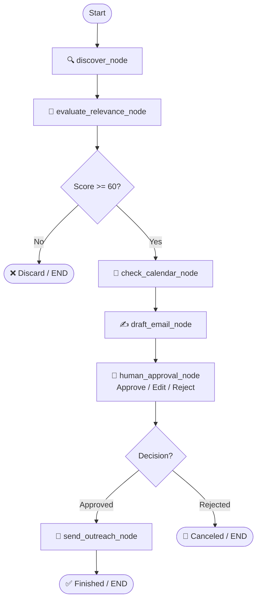

# 🧭 NetworkPilot

> An autonomous networking agent built with **LangGraph** that discovers relevant professionals via Apify, finds shared interests, checks calendar availability for open coffee chat slots, and generates personalized outreach email drafts with **Human-in-the-Loop** approval.

---

## 🎯 Learning Objectives

This project is designed to be **simple, clear, and modular** so you can master the foundations of stateful agent workflows:

1. **State Management**: Using `TypedDict` (`AgentState`) as a shared memory contract that flows between nodes.
2. **Modular Nodes**: Writing decoupled Python functions that take state, do one job, and return updates.
3. **Conditional Routing**: Dynamically deciding workflow paths (e.g., skip low-relevance leads; route based on human approval).
4. **Human-in-the-Loop (HITL)**: Pausing execution for user inspection, editing, and approval before triggering real-world actions.

---

## 🏗️ Architecture & Workflow



---

## 📂 Project Structure

```text
NetworkPilot/
├── cockpit.py        # 🚀 Modern Dark-Mode Agent Cockpit Dashboard (FastAPI)
├── google_service.py # 🔑 Google Calendar availability & Gmail Draft generator
├── GOOGLE_SETUP.md   # 📖 Step-by-step Google Calendar/Gmail OAuth guide
├── state.py          # Central AgentState schema (TypedDict)
├── services.py       # Apify discovery, calendar slots & LLM integrations
├── nodes.py          # LangGraph node functions (discover, evaluate, draft, approve)
├── graph.py          # StateGraph assembly, edges & conditional routers
├── main.py           # CLI runner
├── requirements.txt  # Dependencies
└── .env.example      # Template for API keys
```

---

## ⚡ Quickstart Guide (Run it Yourself)

Follow these steps in your terminal to set up and run the agent:

### 1. Create and Activate a Virtual Environment

**Windows (PowerShell):**
```powershell
python -m venv .venv
.\.venv\Scripts\Activate.ps1
```

*(If you encounter a PowerShell execution policy error, run `Set-ExecutionPolicy -Scope Process -ExecutionPolicy Bypass`)*

---

### 2. Install Dependencies

```powershell
pip install -r requirements.txt
```

---

### 3. (Optional) Configure API Keys

The agent comes with **built-in mock fallbacks** so you can run and test the complete LangGraph workflow immediately without paid API keys!

If you wish to connect real OpenAI or Apify accounts:
1. Copy `.env.example` to `.env`:
   ```powershell
   Copy-Item .env.example .env
   ```
2. Open `.env` and fill in your keys:
   ```env
   OPENAI_API_KEY=sk-...
   APIFY_API_TOKEN=apify_api_...
   ```

---

### 4. Run the Agent

You have two ways to run the agent:

#### Option A: Agent Cockpit Dashboard (Recommended)
Launch the modern dark-mode AI command center with live agent thought streaming, candidate synergy dials, and direct Gmail draft synchronization:
```powershell
python cockpit.py
```
*(Opens at `http://localhost:8000`)*

#### Option B: Terminal CLI
Run the LangGraph workflow directly in your terminal:
```powershell
python main.py
```

---

## 🧩 Key LangGraph Concepts Explained

### 1. State (`state.py`)
In LangGraph, state is passed into each node and returned back:
```python
class AgentState(TypedDict):
    user_name: str
    current_lead: Optional[CandidateProfile]
    match_score: int
    email_draft: Optional[EmailDraft]
    human_decision: Optional[str]
```
Every node receives `state: AgentState` and returns a dict with the specific keys it wants to update.

### 2. Nodes (`nodes.py`)
Each node is a clean Python function:
```python
def evaluate_relevance_node(state: AgentState) -> dict:
    # Computes relevance
    return {"match_score": 85, "status": "evaluated"}
```

### 3. Conditional Edges (`graph.py`)
Instead of a rigid linear pipeline, LangGraph lets you branch dynamically:
```python
def route_by_relevance(state: AgentState) -> str:
    if state["match_score"] >= 60:
        return "check_calendar"
    return END

workflow.add_conditional_edges("evaluate_relevance", route_by_relevance)
```

### 4. Human-in-the-Loop (`human_approval_node`)
The agent pauses before the sensitive action (`send_outreach_node`). You can:
- **`A` (Approve)**: Proceeds to dispatch.
- **`E` (Edit)**: Allows typing revisions to the message body.
- **`R` (Reject)**: Cancels the email dispatch and safely terminates.